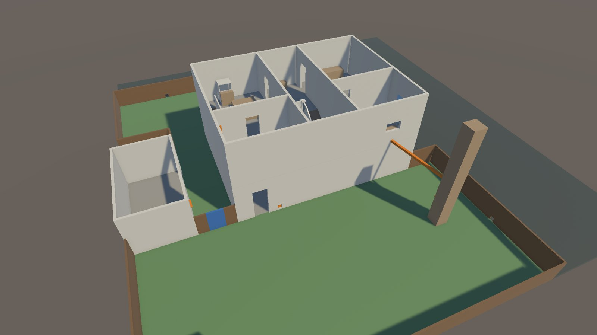
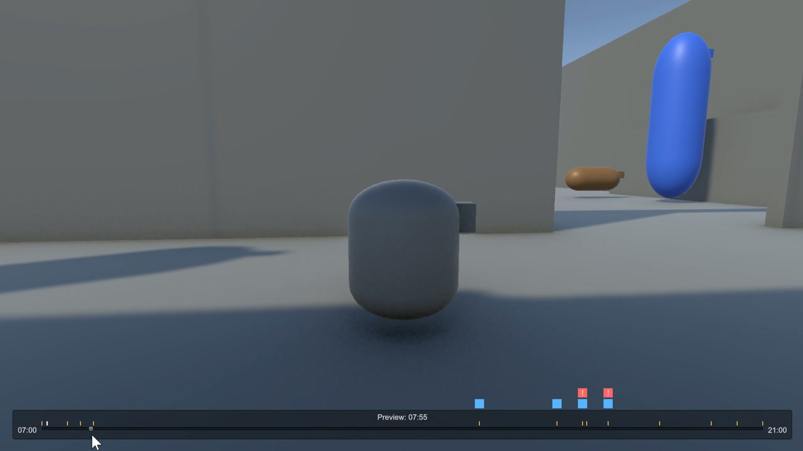
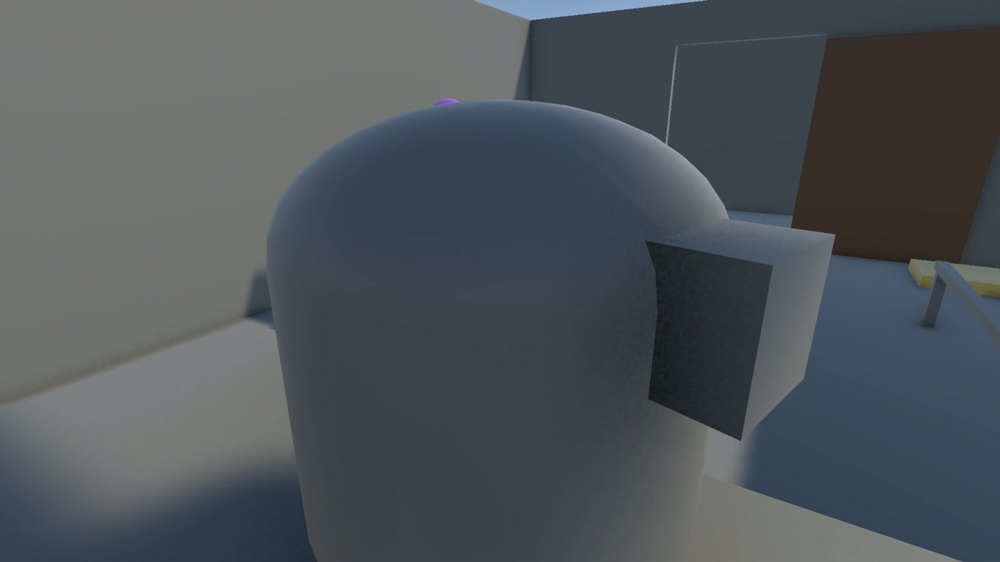
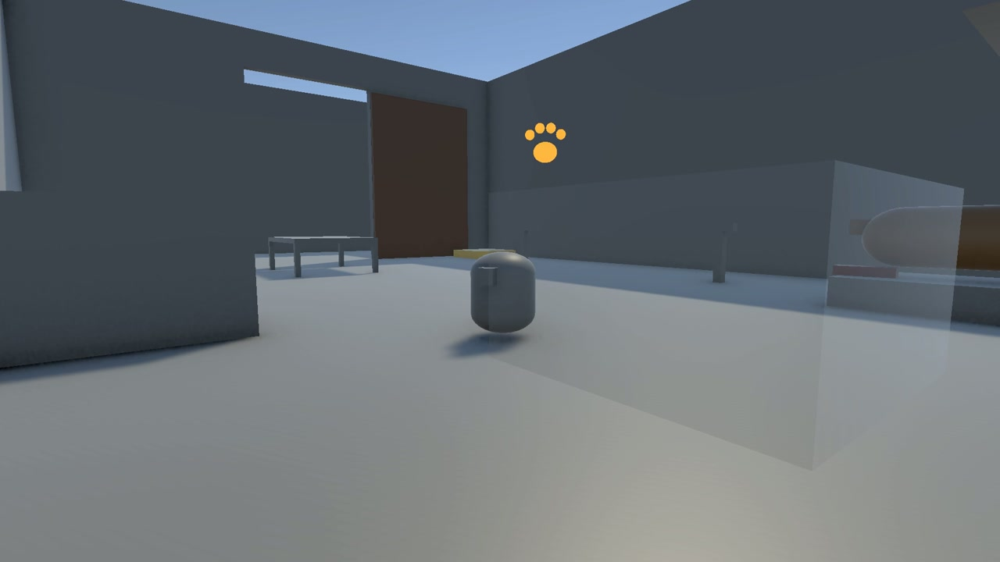
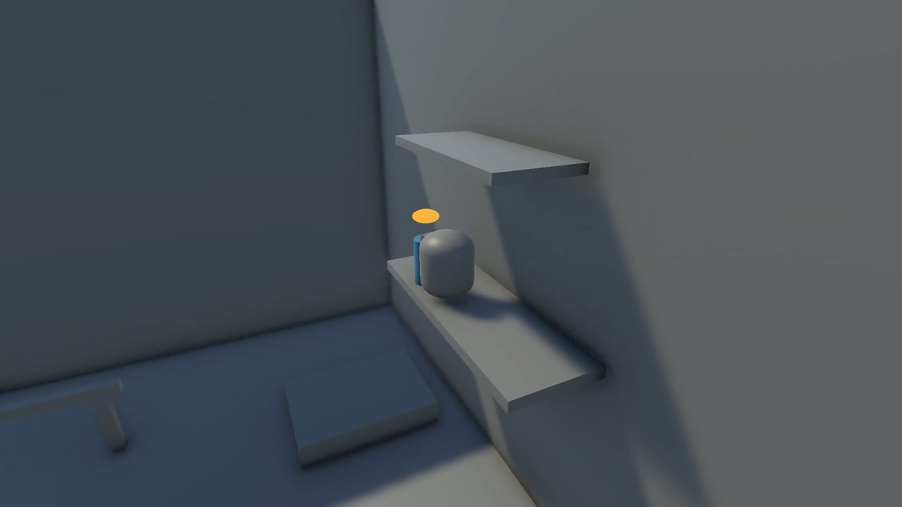
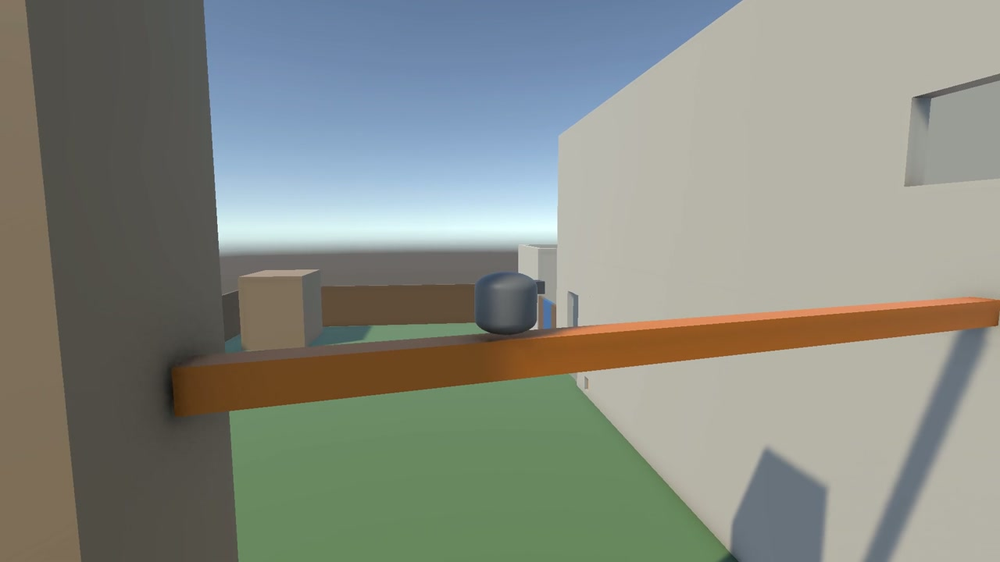
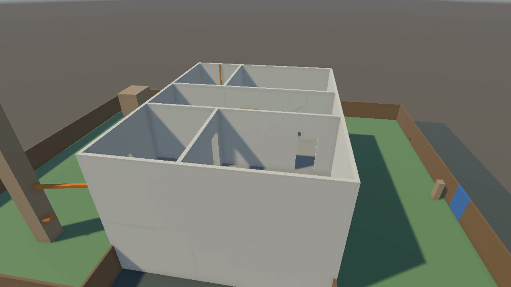

# Psychocat (working title)

Hitman, but you are the family cat, and nobody suspects you.

A 3D third-person stealth sandbox set in one house. You play a secretly evil house cat who builds chain-reaction pranks so the family believes the house is haunted, while every objective pushes toward a bigger goal.

**Status:** early development, started in October 2026. Everything shown here is gray-box: plain blocks, no art yet. It shows how the game plays, not how it will look.

> This repository is a showcase. The source code is kept private for now. If you would like to see code, get in touch.

## The idea

The player plans first, then watches the plan play out. Every action gets a reaction from the world, and the reaction is where the humour comes from. The cat can always read who is where and what is risky, and nobody suspects it, except in places a cat does not belong. Failure costs position or time, never injury, and the family dog, Biscuit, is never harmed.

## What is built

- **A playable prototype in five days** (5 to 9 October 2026): a cat that runs, crouches under furniture, climbs where a paw prompt shows it can, walks thin beams and hides, in a small house with a family on a clock.
- **A planning view.** Family members follow schedules from 7:00 to 21:00 on a game clock, so a day plays out the same way every time. Pressing F freezes the day into a planning view with each person's route, see-through ghosts of where they will be, and a timeline you can scrub.
- **Chains of cause and effect.** Push a vase while Biscuit lies beside it and Mom blames him, or drag a slipper into the dog bed so Dad finds it chewed. Who gets blamed depends on who is where.
- **Vision cones** for every person, shown while planning. Being seen doing something guilty raises suspicion.
- **A written design document** with four design pillars, the cast, and a Level 1 plan with eight paths on paper and five picked for the first slice.
- **A rebuilt base for the real game:** a two-floor house with a front yard, side passage and back garden, built from a written map of rooms, doors and furniture, with a continuous clock and world state kept as data.
- **New jump rules** (up to 1.5 m from standing, 2.0 m across a gap, aimed with the camera) and cat-only routes: a gap behind the shelves, a pipe, a tree branch to a window, a dumbwaiter.

## Videos

| | |
|---|---|
|  |  |
| The planning view: the day is frozen and you scrub the timeline. | A chain: the vase falls, Biscuit barks and Mom blames the dog. |
|  |  |
| A second chain: the slipper goes into the dog bed and Dad finds it chewed. | Vision cones: being seen doing something guilty raises suspicion. |
|  |  |
| A cat-only route: the tree branch to a window. | The rebuilt house, from the front yard to the back garden. |

## Next

Build the first playable slice of Level 1: the house, the family routine from 7:00 to 21:00 and five paths. Playtest it until it is fun, then decide how far to grow. An art style test comes before the content is finished.

## Tech

Unity (URP), C#. Solo developer and designer.
